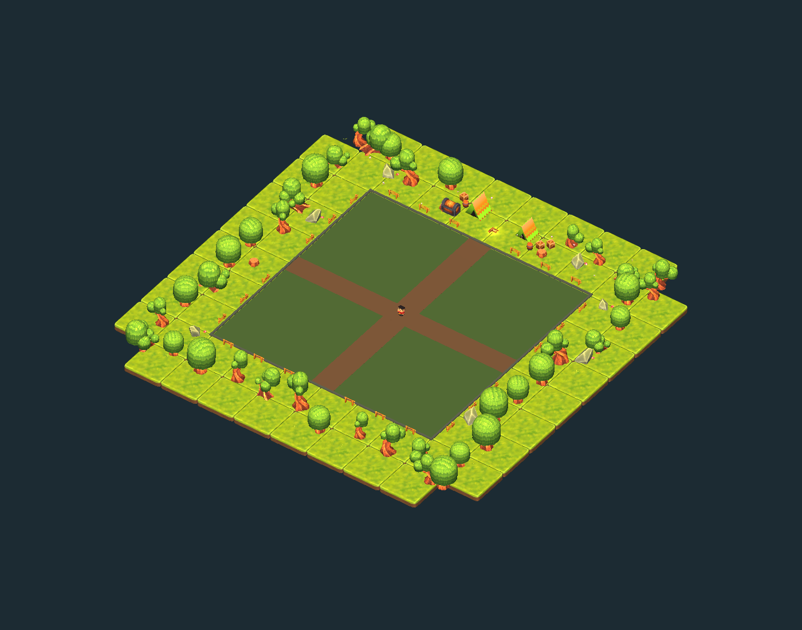

# Survivors3D

一个用 Unity 6 制作的 3D 割草类（Survivors-like）动作游戏原型。玩家在森林营地里抵御一波波敌人，每波结束后用拾取的材料在商店里购买和升级武器，最后挑战森林石王 Boss。



## 功能

- 波次系统：有限战役和无尽模式，波次表可以在编辑器里配置
- 12 种武器（枪、喷火器、十字弓、回旋飞刀、毒液背罐、诱饵灯笼等），可以升级、进化，并组成近战流、毒伤流等流派
- 多种敌人：冲锋、射手、自爆、分裂、石甲等，以及有多个阶段的 Boss
- 冲刺、商店、物品图鉴、中英文界面、手柄和键鼠操作
- 完整的音效和音乐系统，可以调节音量

## 环境要求

- Unity **6000.3.22f1**（Unity 6.3），渲染管线是 URP
- 主要依赖：Input System、AI Navigation，完整列表见 `Packages/manifest.json`

## 快速开始

1. 克隆仓库，用 Unity Hub 打开项目根目录。
2. 打开 `Assets/Scenes/Playground.unity`，点击 Play，再点击 Game 视图让它获得键盘焦点。

`Playground` 场景不依赖任何付费素材，可以直接运行。

## 森林营地场景（需要第三方素材）

`Assets/Scenes/ForestCamp.unity` 使用了 Unity Asset Store 上的付费素材包 **KUBIKOS - World**。这个素材包不允许再分发，所以**没有包含在仓库里**。没有导入它也能打开项目，但森林营地场景里的地形、树木和岩石会显示为缺失。

如果你已经购买了这个素材包：

1. 在 [Unity Asset Store](https://assetstore.unity.com/?q=KUBIKOS) 搜索并下载 KUBIKOS - World。
2. 用 Package Manager 把它导入项目，保持默认路径 `Assets/KUBIKOS - World/`。
3. 素材包里资源的 GUID 和场景里的引用一致，导入后引用会自动恢复。
4. 通过菜单 `Tools > Survivors > Open Forest Camp` 打开场景。

`.gitignore` 已经忽略了这个目录，导入后不会被误提交。

## 编辑器工具

`Tools > Survivors` 菜单下有场景创建、武器和敌人的验证脚本、流派试验场等工具，例如：

- `Wave Configuration`：编辑波次表
- `Verify Audio`、`Verify Forest Layout`：检查音频绑定和场地连通性
- `Melee Build Lab`、`Poison Build Lab`：测试特定流派

## 文档

| 文档 | 内容 |
|---|---|
| [ARCHITECTURE.md](ARCHITECTURE.md) | 运行时模块的职责划分 |
| [PLAYGROUND.md](PLAYGROUND.md) | 玩法规则、波次、武器数值 |
| [WAVE_CONFIGURATION.md](WAVE_CONFIGURATION.md) | 波次表和无尽模式 |
| [WEAPONS.md](WEAPONS.md) | 武器设计 |
| [ITEM_SYSTEM.md](ITEM_SYSTEM.md) | 物品系统 |
| [MELEE_BUILD.md](MELEE_BUILD.md) / [POISON_BUILD.md](POISON_BUILD.md) | 近战流 / 毒伤流 |
| [FOREST_CAMP.md](FOREST_CAMP.md) / [FOREST_LAYOUT.md](FOREST_LAYOUT.md) | 森林营地场景和布局 |
| [AUDIO.md](AUDIO.md) | 音效事件和音乐 |

## 目录结构

```
Assets/
├── Scripts/      # 游戏代码
├── Editor/       # 编辑器工具和验证脚本
├── Resources/    # 角色模型、配置（波次、音频）、字体
├── Audio/Kenney/ # 音效和音乐
├── Materials/
└── Scenes/
ArtSource/        # Blender 源文件、概念图和生成脚本
```

## 许可

- **代码**：[MIT](LICENSE)
- **音频**：来自 [Kenney](https://kenney.nl)，CC0，原始许可见 `Assets/Audio/Kenney/Licenses/`
- **字体**：Noto Sans CJK SC，SIL Open Font License 1.1，见 `Assets/Resources/Fonts/OFL.txt`
- **KUBIKOS - World**：Unity Asset Store 素材，不包含在本仓库中，使用时请遵守 Asset Store 的许可协议
